<div align="center">

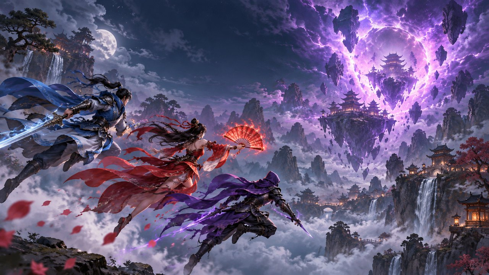

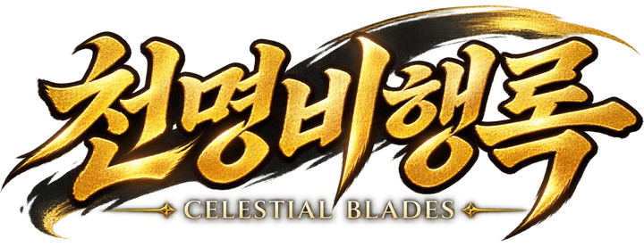

# 천명비행록 · Celestial Blades

**동양 판타지 횡스크롤 탄막 슈팅** — 하늘의 균열을 봉인하라

<a href="https://jeiel85.github.io/celestial-blades/"></a>


</div>

인간계와 천계 사이의 거대한 균열에서 요괴와 기계 생명체가 쏟아져 나옵니다. 하늘을 나는 **천명사** 한 명을 골라 균열의 근원을 추적하세요.

1990년대 아케이드 슈팅의 재미(화면을 채우는 탄막, 캐릭터별 공격 방식, 차지 공격과 필살기, 단계별 보스 패턴)를 웹 기술로 다시 만든 오리지널 게임입니다. 설치 없이 브라우저에서 바로 플레이할 수 있고, PWA로 설치하면 오프라인에서도 실행됩니다.

---

## 천명사

<table>
<tr>
<td align="center" width="33%">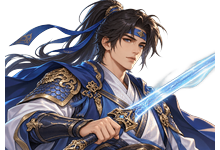<br><b>윤 · YUN</b><br><sub>균형의 검사 · 초보자 추천</sub></td>
<td align="center" width="33%"><br><b>려화 · RYEOHWA</b><br><sub>화염의 술사 · 광역</sub></td>
<td align="center" width="33%">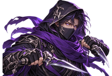<br><b>무영 · MOOYOUNG</b><br><sub>그림자의 암살자 · 최고 DPS</sub></td>
</tr>
<tr>
<td><b>기본</b> 빠른 직선 검기<br><b>차지</b> 거대 초승달 검기 — 적탄 소거<br><b>필살</b> 천명검진 — 2초간 거대 검진</td>
<td><b>기본</b> 3갈래 화염탄<br><b>차지</b> 자동 추적 화염조 5~7기<br><b>필살</b> 홍련화재 — 불기둥 연발</td>
<td><b>기본</b> 초고속 직선 수리검<br><b>차지</b> 전방 돌진 — 경로 대미지 + 순간 무적<br><b>필살</b> 백귀야행 — 잔상이 화면을 가로지름</td>
</tr>
<tr>
<td align="center">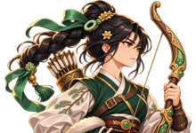<br><b>소율 · SOYUL</b><br><sub>관통의 궁수 · 줄지은 적 관통</sub></td>
<td align="center"><br><b>해랑 · HAERANG</b><br><sub>결계의 술사 · 방어형</sub></td>
<td></td>
</tr>
<tr>
<td><b>기본</b> 적을 꿰뚫는 화살<br><b>차지</b> 천궁일시 — 화면 끝까지 꿰뚫는 거대 화살<br><b>필살</b> 유성시우 — 3초간 화살비</td>
<td><b>기본</b> 약하게 유도되는 부적 + 뒤쪽 견제 부적<br><b>차지</b> 호신결계 — 1.6초간 주변 적탄 소거<br><b>필살</b> 사신결계 — 네 수호신의 결계로 화면 정화</td>
<td></td>
</tr>
</table>

**숨겨진 천명사** — 한 번 클리어하면 강하지만 뚜렷한 약점이 있는 천명사 두 명이 선택 화면에 나타납니다. 캐릭터 선택 화면에 숨겨진 커맨드도 있습니다.

## 스테이지

<table>
<tr>
<td width="50%">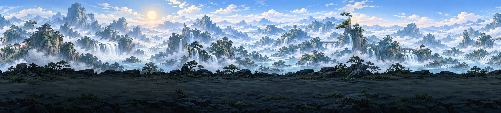<br><b>1 · 청운계곡</b> <sub>AZURE VALLEY</sub><br><sub>보스 <b>철갑귀 장군</b></sub></td>
<td width="50%">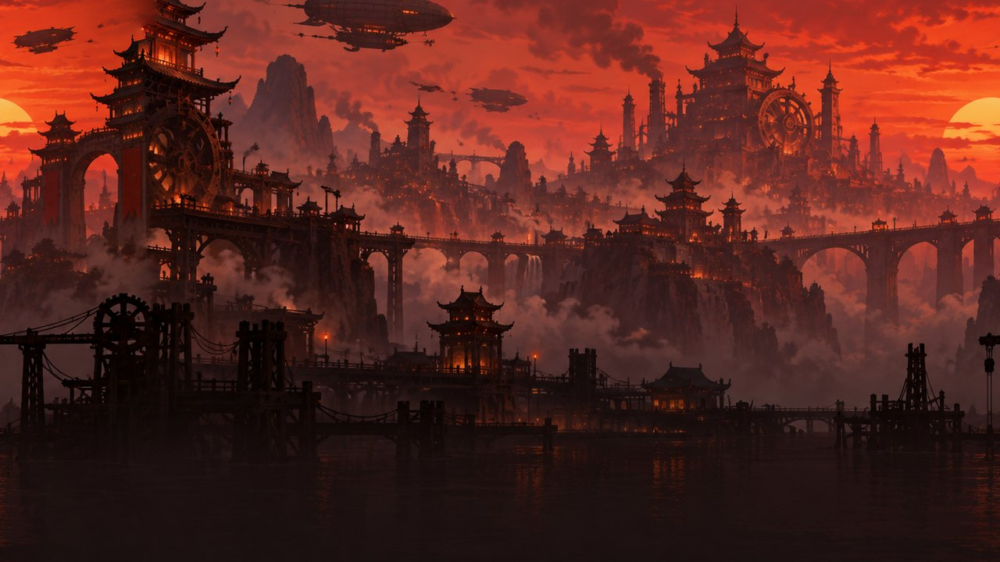<br><b>2 · 붉은 기계도시</b> <sub>CRIMSON MACHINE CITY</sub><br><sub>보스 <b>홍련기관왕</b> — 외장 파괴 후 코어 노출</sub></td>
</tr>
<tr>
<td>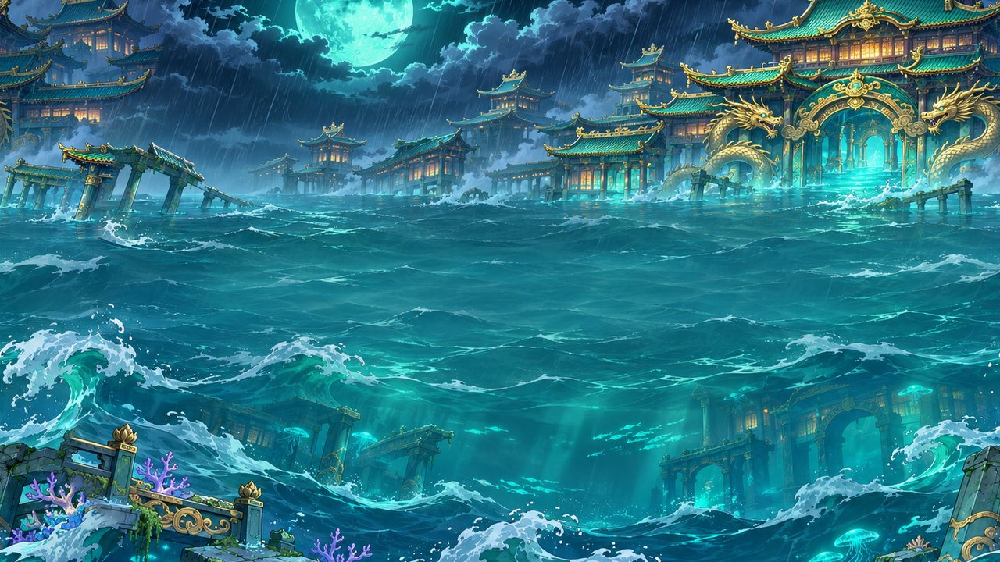<br><b>3 · 수몰용궁</b> <sub>SUNKEN DRAGON PALACE</sub><br><sub>보스 <b>해룡비 청린</b> — 물결 장막·소용돌이·돌진</sub></td>
<td>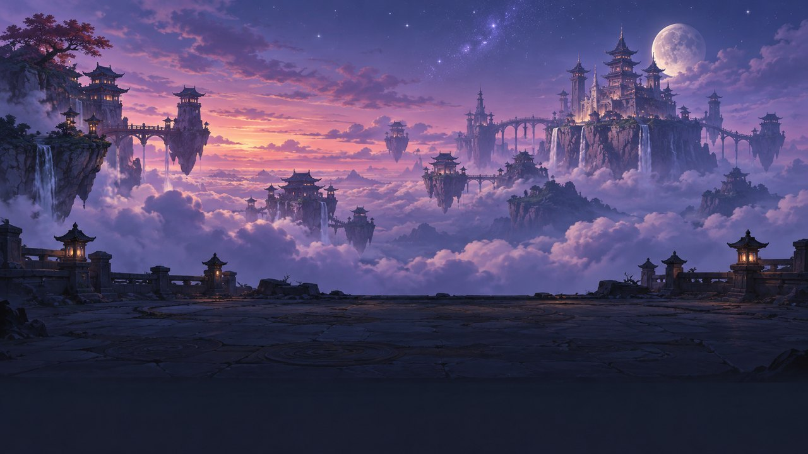<br><b>4 · 천공성</b> <sub>SKY FORTRESS</sub><br><sub>보스 <b>백야천녀</b> — 순간이동·분신, 화면 암전</sub></td>
</tr>
<tr>
<td>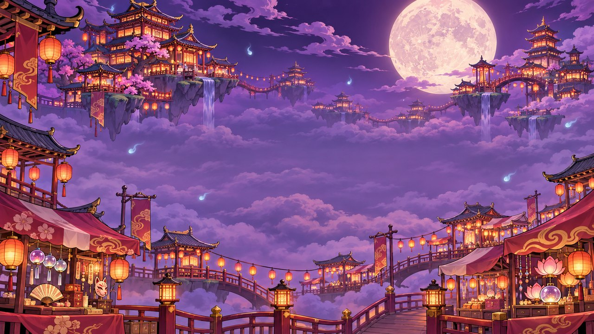<br><b>5 · 백귀야시</b> <sub>HUNDRED-GHOST NIGHT MARKET</sub><br><sub>보스 <b>등롱귀왕 야명</b> — 등롱 4개가 돌며 사격</sub></td>
<td>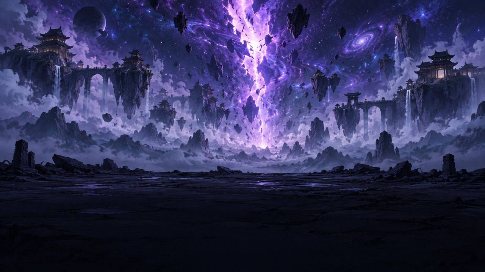<br><b>FINAL · 천문</b> <sub>CELESTIAL RIFT</sub><br><sub>최종 보스 <b>무명천</b> — 인간형 → 거대 신수형</sub></td>
</tr>
</table>

<p align="center">
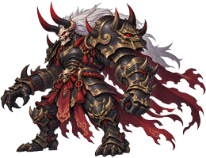
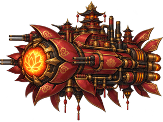
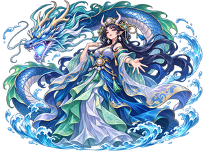

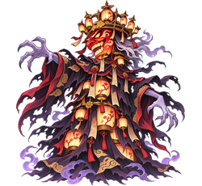
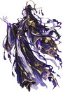
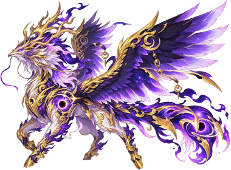
</p>

## 이야기

스테이지 사이마다 일러스트 컷신으로 이야기가 이어집니다. 고른 천명사에 따라 대사가 달라집니다.

<table>
<tr>
<td width="33%">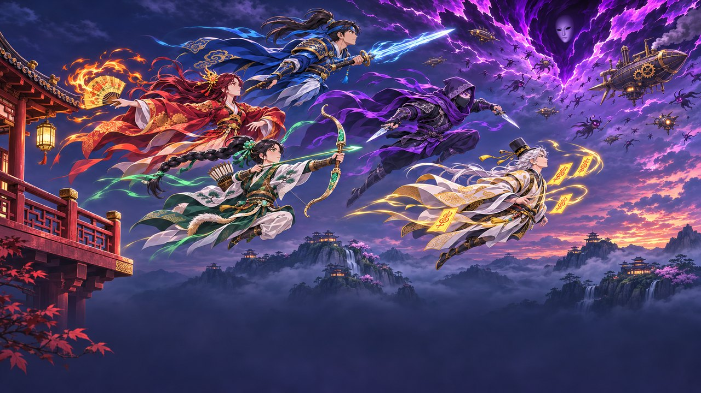<br><sub><b>서장</b> 갈라진 하늘</sub></td>
<td width="33%">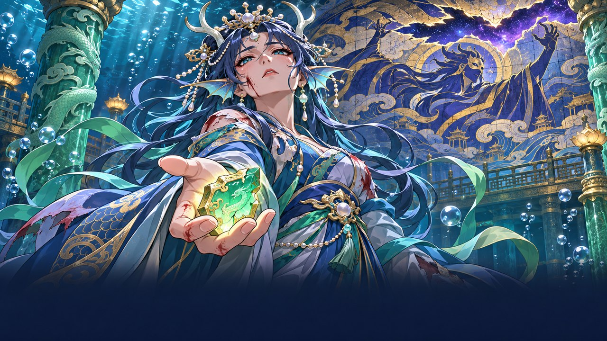<br><sub><b>제3장</b> 용궁의 증언</sub></td>
<td width="33%">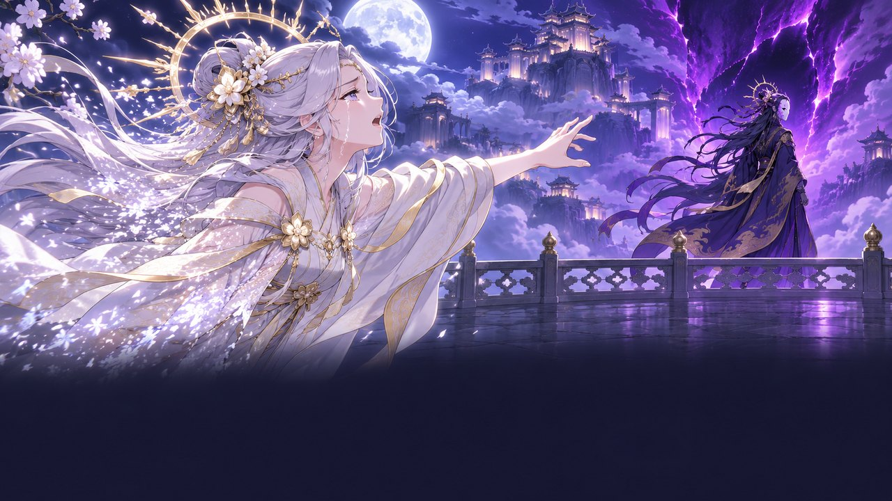<br><sub><b>제4장</b> 백야의 눈</sub></td>
</tr>
</table>

---

## 조작법

| 동작 | 키 |
| --- | --- |
| 이동 | 방향키 / WASD |
| 기본 공격 (홀드 연사) | Z / Space |
| 차지 공격 | 공격 버튼 1.2초 이상 홀드 후 해제 |
| 필살기 | X |
| 집중 이동 (저속 + 피격점 표시) | Shift |
| 일시정지 | ESC |
| 음소거 | M |
| 게임패드 | 스틱/패드 이동, A 공격, B 필살기 |

모바일 브라우저에서는 터치 UI(좌측 가상 이동 영역, 우측 공격/필살기 버튼)가 표시됩니다.

**어시스트**: 타이틀 `SETTINGS`에서 자동 공격 · 자동 필살기 · 자동 회피를 하나씩 켜고 끌 수 있습니다. **모바일에서는 처음부터 켜져 있고**, 처음 실행할 때 안내창으로 알려 줍니다. 켜져 있으면 스테이지 시작 카드와 HUD 점수 아래 `ASSIST`에 표시됩니다. 어시스트를 켠 기록도 온라인 랭킹에 올라가며, 순위표에 `ASSIST 공격·필살·회피`처럼 무엇을 켰는지 표시됩니다.

| 어시스트 | 동작 |
| --- | --- |
| 자동 공격 | 공격키 없이 기본 공격을 계속 쏩니다. 차지는 공격키를 누르고 있다 떼서 씁니다(터치 버튼 글자가 `차지`로 바뀜) |
| 자동 필살기 | 맞는 순간 필살기가 남아 있으면 대신 터뜨려 목숨을 지킵니다 |
| 자동 회피 | 가려는 길로 0.45초 안에 적탄·적에 닿으면 기체가 비켜 갑니다. 안전하면 입력 그대로 움직입니다 |

디버그 키(일반 UI 미노출): `F1` 히트박스, `F2` 무적, `F3` 보스 호출, `F4` 다음 스테이지.

---

## 게임 시스템

- **스테이지**: 5개 메인 스테이지 + 최종 보스전 (첫 클리어 약 30~45분, 동방 시리즈의 6스테이지 구성을 참고)
  1. **청운계곡** — 튜토리얼 리듬의 산맥 (보스: 철갑귀 장군)
  2. **붉은 기계도시** — 기계 문명 도시 (보스: 홍련기관왕 — 외장 파괴 후 코어 노출)
  3. **수몰용궁** — 폭풍의 바다에 잠긴 용궁 (중간보스: 달해파리, 보스: 해룡비 청린)
  4. **천공성** — 구름 위의 부유 성 (보스: 백야천녀 — 순간이동·분신, 체력↓ 시 화면 암전)
  5. **백귀야시** — 구름 위 요괴들의 밤시장 (중간보스: 구미호, 보스: 등롱귀왕 — 등롱 부속)
  6. **천문** — 하늘의 균열 (최종 보스: 무명천 — 인간형 → 거대 신수형 2페이즈)
- **스토리 컷신**: 서장과 각 스테이지 사이 6장, Z로 넘기고 X/ESC로 건너뛰기
- **식신**: 천명사마다 따라다니며 함께 쏘는 수호 식신 — 검령(윤)·화조(려화)·그림자 고양이(무영)·옥매(소율)·종이 인형(해랑). 집중 중엔 앞으로 붙는다
- **보스전 대사**: 보스 등장 직후 보스 ↔ 천명사가 세 마디를 주고받는다(천명사마다 다른 대사, Z 넘기기·X 건너뛰기)
- **탄 소거 → 금화**: 보스 형태가 바뀌거나 쓰러지면 화면의 적탄이 금화로 바뀌어 점수가 된다
- **컨티뉴**: 목숨을 다 잃으면 10초 카운트다운 — 이어 하면 그 자리에서 부활, 점수는 0부터(끝자리 = 이어 한 횟수). EXTREME은 컨티뉴 없음
- **2주차**: 1주차 엔딩 뒤 더 빠르고 촘촘한 2주차에 도전(탄속 1.15배·밀도 1.3배·격파탄, 컷신 생략). 랭킹에 `2주`로 표시
- **스토리 다시보기**: 타이틀 `STORY`에서 본 장과 클리어한 천명사의 엔딩을 다시 보기(장은 대사를 들을 천명사를 ←→로 바꿀 수 있음)
- **차지 공격**: 공격 버튼 홀드 1.2초로 최대 차지, 캐릭터 주위 이펙트로 표시
- **파워**: P 아이템으로 최대 4단계 — 단계마다 투사체 수/형태 변화
- **격추**: 맞으면 가진 파워(P)와 시작 개수를 넘는 필살기(B)가 흩어집니다. 10초 안에 다시 주우면 회복 — 컨티뉴 뒤에도 그 자리에 남아 있습니다
- **필살기**: 최대 4개 보유, 사용 즉시 적탄 소거 + 화면 잡몹 정리 + 보스에 큰 피해, 필살기가 끝날 때까지 무적
- **목숨**: 기본 3, 피격 시 -1 (2초 무적), L 아이템으로 +1
- **콤보**: 빠른 연속 처치로 배율 증가(최대 x3.0), 피격/3초 무처치 시 초기화
- **아이템**: P(파워) / B(필살기) / L(목숨) / G(점수) — 적 처치 시 확률 드롭
- **난이도**: EASY(탄속·밀도 감소) / NORMAL / HARD(탄속·패턴·조합 강화) / **EXTREME**
  - EXTREME: 목숨 1·필살기 0으로 시작, 목숨 아이템 없음, 탄속 1.45배·탄 수 최대 2.4배, 보스 HP 1.6배·공격 빈도 1.35배, 원형 탄막 빈틈 1발분, 적이 죽을 때 격파탄을 남김, 게임오버 시 1스테이지부터 다시. 모든 패턴의 안전 경로는 유지됩니다.
- **점수**: 처치·보스 타격·아이템·콤보·노미스·클리어 보너스, 최고 점수는 localStorage 저장
- **온라인 랭킹**: 게임오버·엔딩 뒤 닉네임으로 등록, 타이틀 `RANKING`에서 난이도별 TOP 20 확인. 어시스트를 켠 기록은 `ASSIST`로 표시
- **필살기 컷인**: 발동 순간 캐릭터 일러스트 컷인이 화면을 가로지르고 공격이 터짐
- **어시스트**: 자동 공격·자동 필살기·자동 회피(설정에서 하나씩, 모바일은 기본 켜짐)
- **보스**: 각 보스 3개 이상 패턴, 체력 감소 시 패턴 추가/강화, 공격 전 경고 연출, 모든 탄막에 안전 경로 존재

---

## 프로젝트 구조

<details>
<summary>디렉터리 구성 펼치기</summary>

```
src/
  assets/sprites/*.png         # 스프라이트 (파일명 = 텍스처 키)
  assets/backgrounds/          # 스테이지 원경(jpg)·전경 레이어(png)·타이틀 키 아트
  main.ts                      # Phaser 게임 부트
  game/
    GameConfig.ts              # 상수·밸런스 수치·IGameWorld 계약·난이도 프리셋
    scenes/
      BootScene.ts             # 그림·글꼴 로드
      TitleScene.ts            # 로고·메뉴·설정·하이스코어
      CharacterSelectScene.ts  # 텐가이식 기체 줄 + 대형 일러스트 + 난이도 선택
      StoryScene.ts            # 스테이지 사이 스토리 컷신
      ArchiveScene.ts          # 스토리 다시보기 (본 장·엔딩 해금)
      GameScene.ts             # 게임플레이 심장 (충돌·물리 진행·보스 흐름·클리어)
      ResultScene.ts           # 게임 오버 / 리트라이
      EndingScene.ts           # 균열 봉합 + 캐릭터별 후일담
    entities/
      Player.ts                # 5캐릭터 이동·공격·차지·필살·피격
      Enemy.ts                 # 풀링 적 엔티티
      Boss.ts                  # 데이터 기반 보스 (페이즈·패턴·연출)
      Bullet.ts                # 플레이어탄/적탄 공용 풀링 탄
    items/Item.ts              # P/B/L/G 아이템 (자석 효과)
    systems/
      EnemySpawner.ts          # 웨이브 타임라인 실행기
      ScoreSystem.ts           # 점수·콤보·배율
      AudioSystem.ts           # Web Audio 합성 효과음 + 절차 생성 BGM
      SaveSystem.ts            # localStorage (하이스코어·설정)
      InputSystem.ts           # 키보드·게임패드·터치 UI
      Assist.ts                # 어시스트 설정·모바일 판별·자동 회피 경로 선택
    effects/Effects.ts         # 폭발·플래시·히트스톱·쉐이크·잔상
    effects/Hud.ts             # 인게임 HUD (점수·목숨·필살기·파워·콤보·보스 체력바)
    effects/Skins.ts           # 적탄 흰 심·외곽선, 기체 테두리 텍스처
    backgrounds/Parallax.ts    # 원경 일러스트 + 전경 레이어 스크롤
    data/
      characters.ts            # 캐릭터 스탯/문구
      stages.ts                # 스테이지 웨이브 타임라인 (데이터 기반)
      story.ts                 # 스토리 컷신 대본 (캐릭터별 대사 포함)
      enemyPatterns.ts         # 적 9종 이동/발사 패턴
      bossPatterns.ts          # 보스 11종 정의 + 공격 함수 레지스트리
    utils/Pool.ts
```

</details>

적 웨이브와 보스 패턴은 씬에 하드코딩되지 않고 `data/`의 타임라인·패턴 데이터로 정의되어 있어, 새 스테이지/보스를 데이터 추가만으로 확장할 수 있습니다.

---

## 개발

```bash
npm install
npm run dev      # http://localhost:5173
npm run build    # dist/ 생성 (tsc 타입 검사 포함)
npm run preview  # 빌드 결과 미리보기
```

`main`에 푸시하면 GitHub Actions가 빌드해 GitHub Pages로 배포합니다. 외부 서버·로그인·백엔드가 없는 순수 클라이언트 게임입니다.

| | |
| --- | --- |
| 엔진 | [Phaser 3](https://phaser.io/) (Arcade Physics, Object Pooling) |
| 언어·빌드 | TypeScript (strict) + Vite |
| 사운드 | Web Audio API — 효과음·BGM 전부 실시간 합성 |
| 저장 | localStorage (하이스코어·설정) |
| 랭킹 | Supabase (PostgREST 직접 호출, RLS·제출 빈도 제한) — [DECISIONS.md](DECISIONS.md) |
| 화면 | 1280×720 (16:9) 자동 스케일링, 60FPS 지향 |
| 글꼴 | 로고 Song Myung, UI Gowun Dodum (둘 다 OFL, `@fontsource`) |

### 그림 파이프라인

모든 그림(캐릭터·적·보스·탄·이펙트·아이템·배경·초상화·엔딩 일러스트·터치 UI)은 Codex 이미지 생성으로 만든 원본을 게임 크기에 맞게 가공해 번들에 포함합니다.

1. 원본 PNG를 `art-raw/<텍스처키>.png`에 둡니다(git 제외).
2. `python tools/process_art.py`를 실행하면 `src/assets/`가 갱신됩니다(Pillow·NumPy 필요). 스테이지 원경·전경 레이어는 `<key>.png` 뒤에 이어 그린 `<key>_2.png`, `<key>_3.png` …를 차례로 이어 한 바퀴 도는 반복 타일로 가공됩니다.

목표 크기는 스크립트의 `SPRITE_SIZES`에 있습니다. 히트박스가 프레임 크기를 기준으로 잡히므로 크기는 바꾸지 않습니다. 파일명이 곧 텍스처 키이고, 코드가 참조하는 그림이 빠지면 부팅 단계에서 오류를 표시합니다.

### 화력 측정

천명사 화력·필살기 피해·보스 격파 시간은 실제 게임 코드를 헤드리스 Chrome에서 빠르게 돌려 잽니다(개발 서버 전용, 배포 빌드에는 들어가지 않음).

```bash
npm run dev -- --host 127.0.0.1 --port 4181
node tools/bench.mjs http://127.0.0.1:4181 midboss_ray
```

결과는 JSON(천명사·파워·방식별 초당 피해, 필살기 1회 피해)입니다. 세 번째 인자로 측정 목록 JSON을 넘길 수 있습니다(`src/dev/bench.ts`의 `BenchCase`, `untilDead: true`면 격파 시간). 화력이나 보스 HP를 바꾸면 다시 재서 `characters.ts`의 `measured`를 고칩니다.

---

## 라이선스

코드와 콘텐츠의 라이선스가 다릅니다.

| 대상 | 라이선스 |
|---|---|
| **코드**: `src/`·`tools/`·`supabase/`·설정 파일. 실행 중 음악·효과음을 만드는 코드도 포함 | [MIT](LICENSE) |
| **콘텐츠**: 그림(`src/assets/`·`public/icons/`·`share/`), 이야기·대사, 캐릭터·보스·스테이지의 이름과 설정 문장 | [CC BY 4.0](LICENSE-CONTENT.md) — 원저작자 표시 |
| **글꼴**: Song Myung·Gowun Dodum | SIL Open Font License 1.1 |

콘텐츠를 쓸 때는 `천명비행록 : Celestial Blades — 박용은 (jeiel85)`, 출처 링크, 라이선스를 함께 적고 고쳤다면 고쳤다고 밝혀 주세요. 범위와 표시 방법은 [LICENSE-CONTENT.md](LICENSE-CONTENT.md)에 있습니다.
